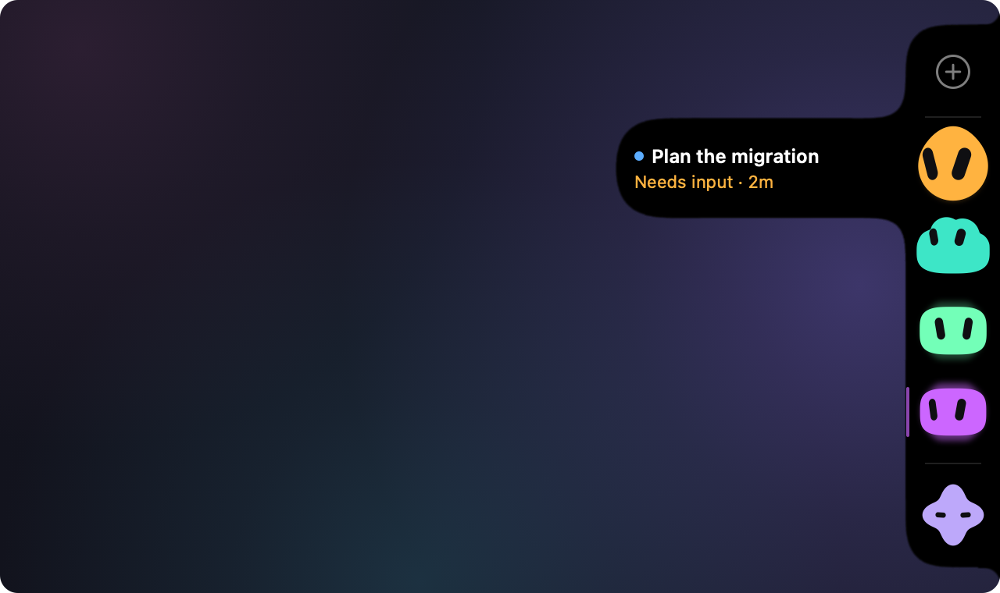

<p align="center">
  
</p>

<h1 align="center">Wallflower</h1>

<p align="center">Your Claude Code sessions, waiting quietly at the edge of your screen.</p>

<p align="center">
  <a href="https://github.com/shainzen1/wallflower/releases/latest/download/Wallflower.dmg"></a>
</p>



## What it is

- A slim black capsule on the edge of your screen (the right one, or the left if you prefer) with one small animated face for every running Claude Code session.
- Each face's shape tells you how that session is doing: it needs you, it's working, it just finished, or it's resting. Hover to read the name and status, click to jump straight to that chat.
- A native macOS menu bar app. It uses no CPU while nothing changes and collects nothing. The only thing it asks the internet is GitHub, once a week, whether there is a newer version.

## Reading the faces

| Face | Meaning |
|---|---|
| Amber drop that hops once, then pulses gently, with a soft halo and a thin amber line on the capsule's edge | **Needs input.** Claude asked you a question. |
| The same, pulsing faster | **Needs permission.** A tool is waiting for your approval. |
| A quick double hop with wide eyes and a brighter body as a face turns into a cloud | **Your message arrived.** A session that was resting or waiting for you starts working again. |
| Cloud with busy eyes | **Working.** The eyes hint at what it's doing: stepping along a line while coding, glancing down while a command runs, reading lines left to right, looking up while it delegates. |
| Little dots orbiting a working face | **Subagents** at work for that session (up to four shown). |
| A burst of mint dots, then a mint glow for a few seconds | **Just finished.** |
| Soft mint capsule looking at you, a faint breathing glow and a quiet mint line on the capsule's edge | **Your turn.** The turn ended and it waits for your next instruction. Lasts 15 minutes, or until you click the face. |
| Muted grey capsule with slow blinks, drowsy after half an hour | **Idle.** Parked: you've seen it, or it has been waiting a while. |
| Grey, flattened, eyes closed, fading out | **Ended.** The session's process exited. |
| Lavender star below a thin divider | An **action face**, a shortcut you set up (see below). |

Colours depend on the Colour setting. With **Status**, amber means needs input, cyan working, mint just finished, lime your turn, warm grey idle and grey ended. With **Project**, every repository gets its own hue (amber, mint and lime keep their meaning, and a parked session dims its hue). **Per session** gives each session its own colour. In every setting the two faces that want you stand out: amber needs input is the loudest, lime your turn comes next, both with a glow and a line on the capsule's edge. With Reduce Motion turned on, faces crossfade instead of moving.

## Install

1. Download **[Wallflower.dmg](https://github.com/shainzen1/wallflower/releases/latest/download/Wallflower.dmg)**, the newest version (the button above is the same file; every version is on the [releases page](https://github.com/shainzen1/wallflower/releases)).
2. Open it and drag **Wallflower** onto the **Applications** folder in the window that appears. Then eject the disk image (the eject button next to it in the Finder sidebar) and delete the download if you like.
3. Open Wallflower from Applications. It is not notarized by Apple yet, so the first launch stops with a message that Apple could not verify Wallflower is free of malware. Click **Done**, go to **System Settings > Privacy & Security**, scroll down and click **Open Anyway**. You only do this once. Or clear the quarantine flag in Terminal before the first launch:

   ```sh
   xattr -dr com.apple.quarantine /Applications/Wallflower.app
   ```

4. A short welcome tour opens. The capsule sits on the right edge of your main display (**Settings > General > Panel side** moves it to the left edge), and a small blob appears in the menu bar.

### Updates

Wallflower checks for a new version once a week and shows what changed. Nothing downloads until you click **Install Update**; the new version then replaces the old one in place and relaunches. **Check for Updates…** in the menu bar menu checks right away, and **Settings > General > Check for updates automatically** turns the weekly check off. Updates come as a zip next to the disk image on each release; you never need to download it yourself. Version 0.1.0 has no updater yet: download the disk image by hand once, and every update after that arrives in the app.

### Build from source

You need the Command Line Tools for macOS 26 (`xcode-select --install`). Xcode itself is not required.

```sh
git clone https://github.com/shainzen1/wallflower.git
cd wallflower
scripts/bundle.sh
mv build/Wallflower.app /Applications/
```

## Requirements

- macOS 26 or later.
- Claude Code, in the Claude desktop app or in a terminal. Wallflower shows its running sessions.
- The Claude desktop app, for opening a chat with a click.

## Using it

- **Hover** over the capsule. The faces magnify like the Dock, and a bulge opens beside the face under the pointer with the session's name, its status, how long it has been in that state and, when known, the git branch.
- **Click** a face to open that chat in the Claude desktop app. Clicking a your-turn face also marks it as seen, so it settles to idle. For a session running in a terminal or editor, Wallflower brings that app to the front.
- **New session:** the plus at the top of the column starts a fresh Claude Code session with no prompt. With sessions shown from the Claude app it opens a new chat there; otherwise it runs `claude` in your home folder in a background Terminal window. Hover it to see where it opens. Turn it off in Settings > General.
- **Drag** the capsule up or down along the edge. It remembers the spot. **Reset position** puts it back in the middle.
- **Left or right:** **Settings > General > Panel side** docks the capsule to the left or the right screen edge. The panel moves at once and everything mirrors: the bulge opens to the right, the faces look and stretch toward the screen, and you throw a face out to the right.
- **Throw** a face out to stop watching that session: drag it away from the screen edge (to the left, or to the right with the panel on the left edge), out of the capsule, and let go, or just fling it. It flies off and stays hidden for the life of that session, even if it later needs you. **Show hidden sessions** in the menu brings them all back.
- **Hide the panel:** with nothing running (no session and no action faces), the column slides off the screen edge, like the Dock. Rest the pointer on that edge where the column was and it slides back out, so the plus is always one move away; it slides away again half a second after the pointer left. **Settings > General > Hide the panel** picks **Never**, **When nothing is running** (the default) or **Always**, which keeps the edge free and brings the column out only while the pointer rests there or a session needs input. With Reduce Motion it fades instead of sliding.
- **Menu bar:** the blob icon shows a status line and your sessions (click one to open it), plus Show hidden sessions, Hide panel, Reset position, Settings… (⌘,), Check for Updates…, Show welcome… and Quit.
- **Settings:**
  - *General:* Launch at login. Check for updates automatically (weekly) and Check Now. Show sessions from the Claude app, from terminals and editors, or everywhere, and sessions from other tools (on or off, see below). New session button (on or off). Panel side (Left or Right), Reset position, and Hide the panel (Never, When nothing is running, or Always). Your actions (add, edit, reorder, remove), where actions run (Terminal or the Claude app) and, for the Claude app, permission to send the prompt (see below).
  - *Appearance:* a live preview. Face (Blob or Dot matrix), Screen filter, Colour (Status, Project, Per session), Shape, Hover (Magnify, Stretch, None). Under Advanced: Goo (Liquid or Crisp), Expand (the row or the whole column) and a face playground.
  - *Agents:* Claude Code (built in), every other agent found on this Mac with Connect, Show, Show changes, Reveal file and Disconnect, the ones not installed and the ones that can't work (with why), and Disconnect all. See [Other agents](#other-agents).
  - *About:* version, links and the welcome tour.

## Action faces

Action faces are shortcuts for prompts you run often. Each one sits below the session faces as a lavender star.

Click one and Wallflower runs `claude "<your prompt>"` in the action's folder, in a new window of your default terminal app that opens in the background. No permission is needed, and you keep working while it runs. The new session shows up in the capsule like any other when **Show sessions from** includes terminals.

Wallflower ships with no actions; you set up your own in **Settings > General > Actions**:

- **+** adds one. Give it a name, the folder the session starts in (type it or click **Choose…**), the prompt and the days it shows on, then click **Add**.
- Double-click an action (or select it and click **Edit…**) to change it. Changes save as you type, and the face in the capsule follows right away.
- **−** removes the selected action. The arrow buttons move it up or down, or drag it onto another row. The capsule shows the actions in the same order.
- The **M T W T F S S** toggles pick the weekdays a face shows on. With all seven on it shows every day; the last day that is on can't be turned off.
- **Model** and **Effort** pick what the session starts with, so a routine prompt can run on a cheaper model. **Default** leaves the choice to Claude Code; **Custom…** takes a full model id. They apply when actions run in Terminal; the Claude app ignores them.

Actions live in `~/Library/Application Support/Wallflower/actions.json`, which starts as an empty list (`[]`). The editor reads and writes this file, so the two never disagree. **Edit JSON…** in the same section opens it in your text editor, for the extra fields below. Changes apply as soon as you save; if the file has a mistake, Wallflower keeps the last version that worked.

```json
[
  {
    "id": "standup-notes",
    "name": "Standup notes",
    "cwd": "~/notes",
    "prompt": "Write today's standup notes from yesterday's commits",
    "days": ["mon", "tue", "wed", "thu", "fri"],
    "model": "sonnet",
    "effort": "low"
  },
  {
    "id": "review",
    "name": "Review open PRs",
    "cwd": "~/projects/my-app",
    "prompt": "/review",
    "shape": "cloud",
    "color": "#7FD1B9"
  }
]
```

| Field | |
|---|---|
| `id` | Required. A stable, unique name for the action. The editor makes it from the name you add the action with (`Standup notes` becomes `standup-notes`, a second one `standup-notes-2`) and keeps it when you rename the action. |
| `name` | Required. Shown when you hover the face. |
| `cwd` | Required. The folder the session starts in (`~` works). The first time, Claude Code may ask whether you trust the folder. |
| `prompt` | Required. The prompt, slash commands included. |
| `seed` | Optional. Changes the face's little quirks. Defaults to the id. |
| `symbol` | Optional. An SF Symbol name, reserved for later use. |
| `shape` | Optional. One of `round`, `squircle`, `pebble`, `bean`, `drop`, `pill`, `softHex`, `cloud`, `star`. |
| `color` | Optional. A body colour as `#RRGGBB`. |
| `days` | Optional. The weekdays the face shows on, as `mon`, `tue`, `wed`, `thu`, `fri`, `sat`, `sun`. Leave it out to show the face every day; unknown values are ignored. The editor's day toggles write this field. |
| `model` | Optional. The model the session runs on, passed to `claude --model`: an alias (`fable`, `opus`, `sonnet`, `haiku`) or a full model id. Leave it out for your Claude Code default. Terminal only; the Claude app ignores it. |
| `effort` | Optional. The effort level, passed to `claude --effort`: `low`, `medium`, `high`, `xhigh` or `max`. Leave it out for the default; an unknown value is ignored. Terminal only, like `model`. |

The editor keeps `seed`, `symbol`, `shape` and `color` as they are when you change an action, so you can set them in the file and keep using the editor.

### Running actions in the Claude app

If you'd rather have action sessions in the Claude desktop app, set **Settings > General > Run actions in** to **Claude app**. A click then opens a new chat in the action's folder with the prompt filled in. The Claude app's link has no way to pick a model, so an action's `model` and `effort` only apply in Terminal. The folder has to be one the Claude app already trusts; for a new folder, Claude asks first and nothing is sent.

The Claude app's link for a new chat can only fill the prompt in, not send it. To send it for you, Wallflower presses Return in Claude, which needs Accessibility permission: turn on **Allow sending** in the same section and allow Wallflower in System Settings. It only ever types into the Claude app, only for a few seconds after your click, and never touches text that isn't the action's prompt. Without the permission, the prompt waits in Claude's composer and the face reminds you to press Return. Because releases aren't signed with a Developer ID yet, macOS may ask for the permission again after you update Wallflower.

## Other agents

Wallflower is built around Claude Code, and it can watch other coding agents too. Connect them in **Settings > Agents** (or tick them in the welcome tour): Wallflower adds a small hook to that agent's settings, shows you every line first, keeps a backup, and takes it all out again on Disconnect. The faces, colours, sorting and hover work as for Claude sessions, and the hover names the agent in a small grey label after the session name.

| Agent | Working | Needs input | Needs permission | Your turn | Ended |
|---|---|---|---|---|---|
| Claude Code | yes | yes | yes | yes | yes |
| Codex (CLI, the ChatGPT app, VS Code) | yes | shows as working | yes | yes | yes |
| GitHub Copilot (CLI, VS Code) | yes | yes | yes | yes | yes |
| Gemini CLI | yes | shows as working | yes | yes | yes |
| Cursor | yes | no | no | yes | yes |
| OpenCode 1.x | yes | yes | yes | yes | yes |
| Windsurf / Devin Desktop | yes | no | no | yes | when Windsurf quits |
| Devin CLI | yes | shows as working | yes | yes | yes |
| Goose (experimental) | yes | no | no | yes | yes |

Coming later: Amp, Kiro CLI, Aider, Antigravity CLI. Not possible: **ChatGPT chats** (ChatGPT doesn't share chat status with other apps; Codex inside the ChatGPT app works), regular Claude app chats (only Claude Code sessions report their status), Zed's and Warp's own agents, Roo Code, Cline for now, and cloud agents. Codex needs one extra step: it runs a new hook only after you trust it once (`/hooks` in Codex). [docs/agents.md](docs/agents.md) has the details per agent: what it shows, which file Wallflower touches, and the safety rules every connection follows.

Any other tool, or your own script, can show up as well. The tool, or a small wrapper around it, writes one JSON file per session into `~/Library/Application Support/Wallflower/sessions/`: an id, a status (`busy`, `idle` or `waiting`), and optionally a name, a folder, a process id and what a click should open.

The helper script [`scripts/wallflower-session`](scripts/wallflower-session) writes those files from a shell or a hook, with nothing to install:

```sh
wallflower-session start --id "codex-$$" --tool codex --cwd "$PWD" --pid $$ --status busy
wallflower-session status --id "codex-$$" waiting --waiting-for permission
wallflower-session end --id "codex-$$"
```

[docs/external-sessions.md](docs/external-sessions.md) has the file format, the lifecycle, a wrapper that gives any CLI a face, and notes on lifecycle hooks. Turn all of these sessions off in **Settings > Agents > Sessions from other tools**, or one agent's faces with its **Show** switch in Settings > Agents.

Before you delete Wallflower, click **Settings > Agents > Disconnect all**: it removes every hook it added and puts each changed file back. A hook left behind only fails quietly.

## How it works

Claude Code keeps a small file for every running session in `~/.claude/sessions/`, with its name, folder and status (busy, idle or waiting for you). Wallflower watches that folder and each file with kernel file events, checks that the process is still alive and notices the moment it exits. For a working session it reads the last part of the session's transcript to see which tool is running and how many subagents are active. Clicking a face opens the chat through the Claude app's `claude://code/continue` link. All animation runs in Core Animation, so the app itself does nothing between changes.

The performance contract: 0 % CPU at rest, no polling and no timers, every animation loop runs in Core Animation, one window resize per change (never per frame), and under about 30 MB of memory.

## Privacy

Wallflower reads only these local files and never writes to them:

- `~/.claude/sessions/*.json`, the session registry.
- The end of each shown session's transcript in `~/.claude/projects/` and its subagent files, to tell what it is doing.
- `.git/HEAD` in the session's folder, for the branch name.
- `~/Library/Application Support/Wallflower/sessions/*.json`, the session files other tools write (see [Other agents](#other-agents)).
- The settings files of the agents you connect (`~/.codex/hooks.json`, `~/.gemini/settings.json`, ...), and only once you open Settings > Agents or tick an agent in the welcome tour. Before that it only checks whether their folders exist.

It writes only its own settings (including the list of hidden sessions), `~/Library/Application Support/Wallflower/` (`actions.json`, the small launch scripts action faces run in Terminal, and for connected agents a backup of each file it changed and a record of what it wrote), and, when you connect an agent and agree to the change it shows, that agent's hook file and the helper at `~/.local/share/wallflower/bin/wallflower-hook`. The hook tells Wallflower only that a session is working, waiting or done, never your prompts or replies. To check whether Codex trusts its hook, Settings > Agents briefly starts Codex's own `codex app-server` when you open the tab or connect Codex; it talks to nothing but that local process. Once a week it asks GitHub whether there is a newer version: it downloads `appcast.xml`, a small file with the latest version number and its release notes, from the project's latest release, and the update itself only when you choose to install it. Like any web request, this shows GitHub your IP address and, in the user agent, the Wallflower version. It sends no system profile, no analytics and no telemetry, and nothing else leaves your Mac. Turn the check off in **Settings > General > Check for updates automatically**.

## Limitations

- The session registry and the Claude app's deep links are not documented by Anthropic. A Claude Code or Claude app update can change them, and Wallflower may then show less, or nothing, until it is updated. It was built against Claude Code 2.1.29x.
- The capsule lives on the main display only.
- Clicking a terminal session brings its terminal app forward, not the exact window or tab.
- The release build is not notarized yet (see Install).

## Contributing

Bug reports, ideas and pull requests are welcome. Start with [CONTRIBUTING.md](CONTRIBUTING.md). [docs/DEVELOPMENT.md](docs/DEVELOPMENT.md) explains the architecture and the debugging flags, [docs/registry-format.md](docs/registry-format.md) describes the Claude Code files Wallflower reads, [docs/agents.md](docs/agents.md) how other agents are connected, and [docs/external-sessions.md](docs/external-sessions.md) the session files other tools can write.

## Support

Wallflower is free. If it makes your day a little calmer, a star on GitHub helps others find it.

## Credits

Made by [Shain Gerstner](https://github.com/shainzen1) at [osoro.studio](https://osoro.studio).

## License

MIT License with Commons Clause: free to use, change and share, not to sell. See [LICENSE](LICENSE). Versions up to 0.1.1 were released under the plain MIT License.

Wallflower ships [Sparkle](https://sparkle-project.org) for in-app updates, under its own MIT license; see [THIRD_PARTY_NOTICES.md](THIRD_PARTY_NOTICES.md).

Not affiliated with or endorsed by Anthropic. Claude is a trademark of Anthropic.
